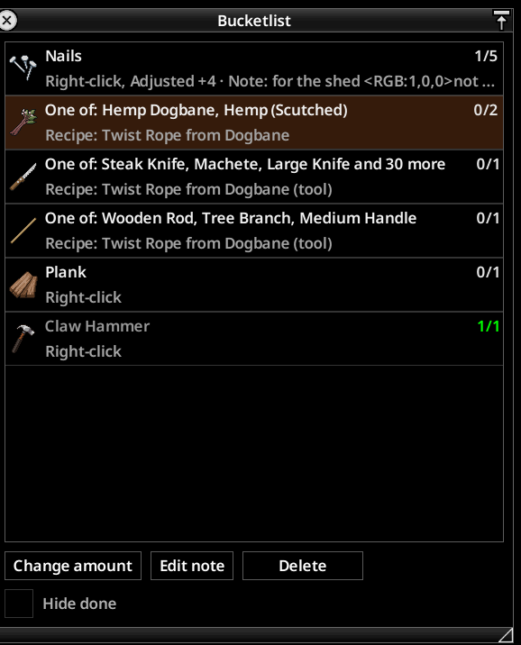
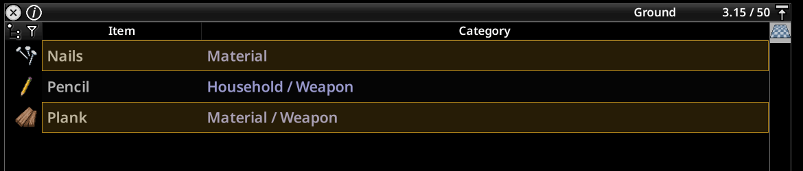
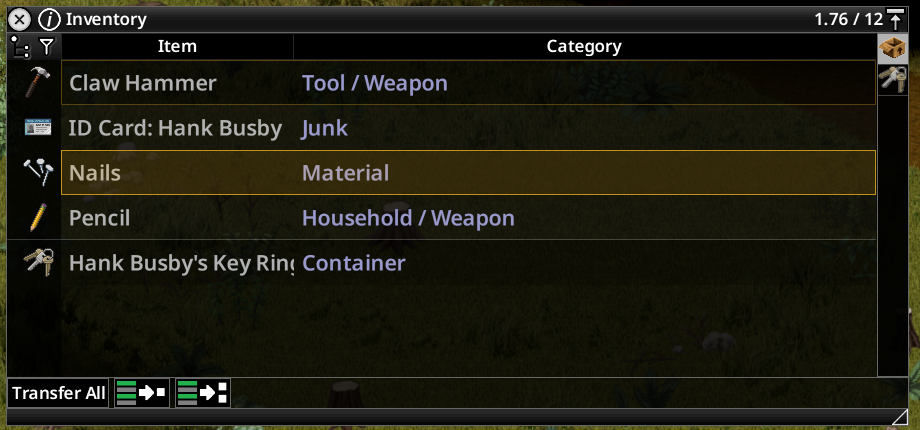
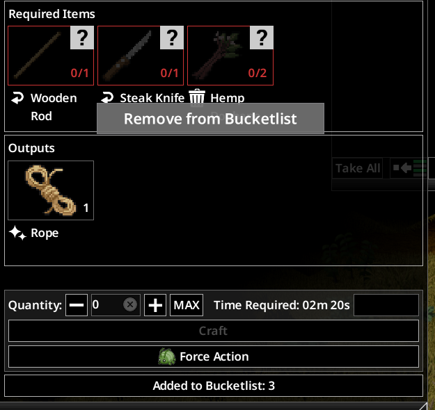
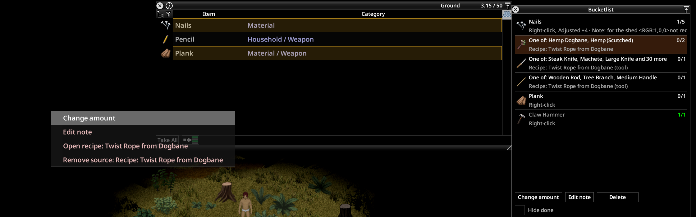
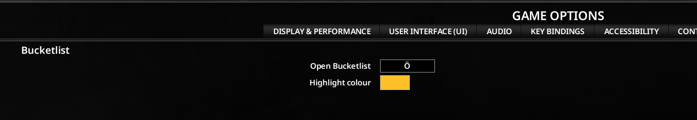

# Shopping List

A wishlist and loot tracker for Project Zomboid (Build 42.21 and later): put items on your
character's list with a right-click, see them highlighted in loot and inventory, and add missing
crafting ingredients with one click.

Steam Workshop: https://steamcommunity.com/sharedfiles/filedetails/?id=3817246291

## Features

- **Right-click** an item in the inventory, loot, hotbar or hand slots: "Add to Shopping List", or
  "Remove from Shopping List" when it is listed already. Several selected item types at once work too.
- **Shopping List window** (sidebar button under the vanilla buttons, or the hotkey): icon, name,
  carried and wanted amount, sources and note per entry. Change the wanted amount, edit the note,
  delete entries (second click confirms), hide entries that are done. Right-click a row to open its
  recipe or remove a single source.
- **Highlight**: rows of listed items that are still wanted get a coloured frame in the inventory and
  loot windows. The colour is set in the mod options.
- **Tooltip**: listed items show carried and wanted amount, sources and note below the item tooltip.
- **Crafting window**: right-click a single ingredient or tool to add it (or take it off again); the
  button "Missing ingredients to Shopping List" puts every missing input of the
  selected recipe on the list, with the recipe as source. Inputs with alternatives become one entry
  that is fulfilled by any of them; tools are needed once, however many recipes use them.
- **Sources**: every entry knows why it is on the list: right-click, recipe, or your manual change.
  The wanted amount is the sum of the consumed sources plus the largest tool source; removing a
  source lowers it by exactly that share.
- The list belongs to the character and is saved with it.

## Screenshots

Taken in game 42.21.0 with version 1.1.0.

| | |
|---|---|
|  | The window: carried and wanted amount, sources and note per entry. Recipe inputs with alternatives are one entry ("One of"), done entries turn green. |
|  | Listed items are framed in the loot window. |
|  | In the inventory too: nails are still missing (filled), the hammer is done (faint frame). |
|  | Crafting window: the button adds everything missing, a right-click on a single ingredient adds or removes just that one. |
|  | Right-click a row to change the amount, edit the note, open the recipe or drop a single source. |
|  | Hotkey and highlight colour in the mod options. |

## Controls

| What | How |
|---|---|
| Add or remove an item | right-click the item |
| Open or close the window | sidebar button, or the key K; rebind it in Options, Mods, Shopping List |
| Close the window | X, ESC or the hotkey |
| Change amount, edit note | buttons under the list, or right-click a row |
| Missing recipe inputs | button in the crafting window and at workbenches |
| A single recipe input | right-click the ingredient or tool in the crafting window |

## Multiplayer

Shopping List has no server code, but Project Zomboid only loads mods that the server lists. To use it
in multiplayer, the server must have `ShoppingList` in `Mods=` (and its workshop id in `WorkshopItems=`),
and clients need the same version. The same applies to co-op hosting. The list is stored in the
player's data and sent to the server after each change. Multiplayer has not been tested yet.

## Known limits

- Amounts count pieces: blunt, rotten or empty items count as carried; fluids and "any item" inputs
  are not put on the list.
- The window, hotkey and sidebar button are for the keyboard and mouse player (player 1). The
  right-click option also works with a controller.
- The build menu has no "missing ingredients" button.
- Furniture items (moveables) cannot be listed.
- Simplified Chinese: in game version 42.21.0 the game's Chinese font has no glyphs for many
  Simplified characters, so parts of the game's own texts and of the mod's texts do not show. The
  CN texts could therefore only be checked against the game's translation files, not on screen.
- The game opens the window again on loading if it was open when you quit (vanilla behaviour).

## Languages

English and German are written by hand. French, Spanish, Brazilian Portuguese, Italian, Polish,
Russian, Ukrainian, Turkish, Simplified and Traditional Chinese, Japanese and Korean are machine
translated: the terms follow the game's own translation files and every language was looked at in
game, but no native speaker has read them yet. All other languages show the English texts.
Corrections are very welcome:

- in the Steam Workshop discussion "Translations" of the mod, or
- as a GitHub issue or pull request with the files in
  `mod/ShoppingList/common/media/lua/shared/Translate/<LANGUAGE>/` (same keys as `EN`; check them
  with `python3 -I tools/i18n_check.py`).

Please name the language, the text key (for example `IGUI_ShoppingList_HideDone`) and your proposal.

## Development

- `lua5.1 tests/run.lua`: tests of the pure logic (data model, rows, geometry, craft inputs).
- `python3 -I tools/kahlua/compile_all.py`: compiles every Lua file with the game's own Kahlua.
- `python3 -I tools/i18n_check.py`: checks all translation files (format, keys, placeholders,
  fonts are checked by hand).
- `python3 -I tools/apicheck.py`: checks every game interface listed in `docs/API.md` against the
  installed game.
- `tools/start-game.sh --test all`: starts the game in a separate user folder with the dev helper
  mod and runs the in-game tests.
- `tools/build-workshop.sh`: assembles the workshop upload folder in `workshop/ShoppingList/`.

The dev helper mod `mod/ShoppingListDev` is only for these tests and is not part of the workshop
upload. Design decisions are in `docs/DECISIONS.md`; `docs/API.md` lists every game function,
class and event the mod uses, each with file and line in the installed game.

## How it was made

Built with AI assistance (Claude Code). Every game API call is checked against the installed game,
and the mod is tested in game by the author.

## License

MIT, see `LICENSE`.
